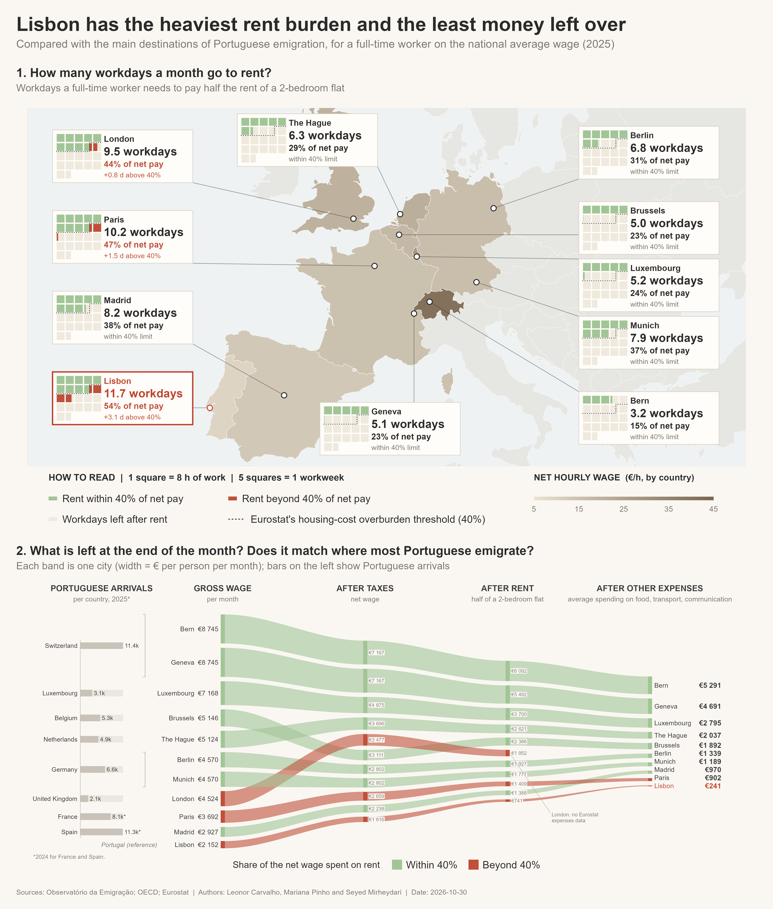

# Lisbon Has the Heaviest Rent Burden and the Least Money Left Over

Group project for the course Data Visualization and Preparation (MSc in Data Science and Engineering, 2026/27). The project compares housing affordability and disposable income in Lisbon with ten cities in the main destination countries of Portuguese emigration, for a full-time worker on the national average wage in 2025. The result is a single static figure built in R with ggplot2, which combines a map of Europe with waffle charts and a Sankey diagram.



## Authors (Team T03)

- Leonor Carvalho
- Mariana Pinho
- Seyed Mirheydari

## Research questions

| | Question | Chart |
|---|---|---|
| **RQ1** | How many workdays per month does a full-time worker need to pay their share of the rent of a two-bedroom flat in Lisbon, compared with cities in the main destination countries of Portuguese emigration? | Map with waffle charts |
| **RQ2** | How much of the monthly wage is left after taxes, rent and everyday expenses in each of these cities? | Sankey diagram |
| **RQ3** | Is the choice of destination by Portuguese emigrants consistent with the countries whose cities leave the most money at the end of the month? | Sankey diagram and arrivals bars |

RQ1 expresses rent in working time instead of euros, which makes cities with very different wage levels directly comparable. As a reference for affordability, the project uses the Eurostat housing cost overburden threshold, under which housing costs above 40% of disposable income are considered excessive.

### Cities

Lisbon (reference), Madrid, Paris, Brussels, The Hague, Luxembourg, Berlin, Munich, Bern, Geneva and London.

## Data

| Dataset | Source | Level | Year |
|---|---|---|---|
| Average annual gross wages | OECD | Country | 2025 |
| Income tax and employee social security contributions (single person, no children, average wage) | OECD Taxing Wages | Country | 2025 |
| Annual exchange rates (`ert_bil_eur_a`) | Eurostat | Country | 2025 |
| Average monthly rent of a two-bedroom flat (`prc_colc_rents`) | Eurostat | City | 2025 |
| Nominal expenditure per inhabitant on food, transport and communication (`prc_ppp_ind`) | Eurostat | Country | 2024 |
| Arrivals of Portuguese nationals | Observatório da Emigração | Country | 2025 (2024 for France and Spain) |

### Assumptions

- Full-time work of 40 hours per week and 52 weeks per year (2,080 hours), with eight-hour workdays.
- Each worker shares a two-bedroom flat with one other person and pays half of the rent.
- Net wage is the gross wage minus income tax and employee social security contributions.
- Monthly living expenses are the sum of the three expenditure categories divided by 12.
- Emigration data exist only by country, so cities in the same country share the same value (Bern and Geneva, Berlin and Munich).
- Missing values are not imputed. The United Kingdom has no data in the expenditure series, so London is left out of the last stage of the Sankey diagram.

### Derived indicators

| Indicator | Calculation |
|---|---|
| Net monthly wage | Net annual wage / 12 |
| Net hourly wage | Net annual wage / 2,080 |
| Rent share | Monthly rent / 2 |
| Workdays needed to pay rent | Rent share / net hourly wage / 8 |
| Share of net wage spent on rent | Rent share / net monthly wage × 100 |
| Left after rent | Net monthly wage − rent share |
| Left at the end of the month | Left after rent − monthly living expenses |

## Repository structure

```
.
├── README.md
├── Report.pdf                        # project report
├── T03_visualization.png             # final visualization
├── T03_main.R                        # main script, builds the final figure
├── T03_project_data.xlsx             # processed data used by the figure
├── T03_intermediate_Rfiles/
│   ├── T03_data_preparation.R        # builds T03_project_data.xlsx from the raw data
│   ├── T03_map_plot.R                # map with waffle charts (RQ1)
│   └── T03_sankey_plot.R             # Sankey diagram and arrivals bars (RQ2 and RQ3)
└── T03_intermediate_Datasets/        # original data
    ├── T03_annualSalary.xlsx         # OECD, gross wages
    ├── T03_labourTaxation.xlsx       # OECD, taxes and contributions
    ├── T03_euroConversion.xlsx       # Eurostat, exchange rates
    ├── T03_MonthRents.xlsx           # Eurostat, rents
    ├── T03_expenses.xlsx             # Eurostat, expenditure per inhabitant
    └── T03_emigration.xlsx           # Observatório da Emigração, arrivals
```

## How to run

1. Keep the folder structure as it is and set this folder as the working directory in R.

   ```r
   setwd("path/to/this/folder")
   ```

2. Install the packages.

   ```r
   install.packages(c("readxl", "dplyr", "tidyr", "writexl", "ggplot2",
                      "sf", "rnaturalearth", "rnaturalearthdata",
                      "patchwork", "ragg"))
   ```

   The map script needs ggplot2 3.5.0 or later.

3. (Optional) Rebuild the processed data from the original files. `T03_project_data.xlsx` is already included, so this step can be skipped.

   ```r
   source("T03_intermediate_Rfiles/T03_data_preparation.R")
   ```

4. Create the final figure.

   ```r
   source("T03_main.R")
   ```

   The figure is saved as `T03_visualization.png` (300 dpi). Each panel script can also be run on its own, in which case it saves its own PNG (`T03_map_plot.png` or `T03_sankey_plot.png`).

## Design

- **Map with waffle charts (RQ1).** Each city has a card with a waffle chart in which one square is one eight-hour workday and one row of five squares is one working week. A dashed stepped line marks where the 40% threshold falls in the month. The map uses the Lambert Azimuthal Equal-Area projection (EPSG:3035), and countries are filled with a sequential scale of the net hourly wage.
- **Sankey diagram (RQ2 and RQ3).** Each city is a band that runs from the gross wage to the amount left after taxes, rent and everyday expenses. Band width is proportional to euros per person per month, with the same scale in every column, and cities are sorted by value in each column, so bands cross when a city changes position. Bars on the left show the number of Portuguese arrivals in each country.
- **Colour.** Green marks cities where rent stays within 40% of the net wage and red those above it, with the same code in both charts. The wage scale is brown and the arrival bars are grey, so neither is confused with the affordability colours. The figure was checked with the colour vision deficiency emulator of the `colorspace` package.

## Main findings

- **RQ1.** Lisbon is the least affordable city. A worker on the average Portuguese wage needs 11.7 workdays a month to pay their share of the rent, 54% of the net wage. Paris (47%) and London (44%) are the only other cities above 40%, and Madrid is close to the limit (38%). Rent in Lisbon is the same as in Berlin (€1,750 per month), where it takes only 6.8 workdays, so the problem lies in the gap between rents and wages more than in the level of rents.
- **RQ2.** The gap widens at each stage of the month. After taxes, rent and everyday expenses, a worker is left with €241 in Lisbon, against about €900 to €1,000 in Paris and Madrid, €2,795 in Luxembourg and €5,291 in Bern. Taxes range from 18% of the gross wage in Switzerland to around 39% in Belgium and Germany, which is why Brussels ends the month behind The Hague despite a lower rent.
- **RQ3.** The link between migration flows and financial outcome is only partial. Switzerland receives the most Portuguese emigrants and leaves the most money at the end of the month, but Spain and France receive the next largest flows while Madrid and Paris leave little more than €900. Luxembourg offers the second-best outcome but receives only about 3,100 Portuguese a year, which points to other factors such as proximity, language and existing Portuguese communities.

## Limitations

- Wages and everyday expenses are national averages, while rents are city values, so the rent burden may be overestimated in capitals where wages are above the national average.
- The average wage is pulled up by high earners and is usually above what a typical worker or a recent emigrant earns.
- The Eurostat rent series refers to dwellings of a relatively high standard, which may inflate rents where the gap between high-end and average housing is wide.
- Everyday expenses cover only food, transport and communication, so the amount left at the end of the month is an upper estimate.
- The 40% threshold is applied to rent alone, while Eurostat uses total housing costs and household income.
- Data combine 2024 and 2025, and each country records foreign arrivals in its own way.

The full discussion, the earlier versions of the figure and the references are in the report, [`Report.pdf`](Report.pdf).

## Tools

R, with readxl, dplyr, tidyr and writexl for data preparation, ggplot2 and patchwork for the figure, sf, rnaturalearth and rnaturalearthdata for the map, and ragg for the PNG export.
